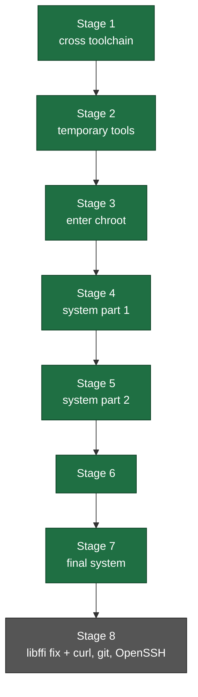

<div align="center">

```text
                                           _     _____ ____       ___  _   _     ____  _____ _____
                                          | |   |  ___/ ___|     / _ \| \ | |   / ___||_   _|_   _|
                                          | |   | |_  \___ \    | | | |  \| |  | |  _   | |   | |
                                          | |___|  _|  ___) |   | |_| | |\  |  | |_| | _| |_  | |
                                          |_____|_|   |____/     \___/|_| \_|   \____||_____| |_|
```

#  Linux From Scratch, built in the cloud, for ARM64

**A complete, reproducible LFS 13.0 (systemd) root filesystem for `aarch64`,**
**compiled from source by chained GitHub Actions stages. No local build machine needed.**

<br>


<br>

[**Why?**](#-why-does-this-exist) ·
[**How it works**](#-how-it-works) ·
[**Stages**](#-the-stages) ·
[**Try it**](#-try-it-yourself) ·
[**Proof**](#-proof-dont-trust-verify) ·
[**Lessons**](#-lessons-learned-the-bugs-that-bit-us) ·
[**Roadmap**](#-roadmap)

</div>

---

##  Table of contents

- [TL;DR](#-tldr)
- [Why does this exist?](#-why-does-this-exist)
- [What you get](#-what-you-get)
- [How it works](#-how-it-works)
- [The stages](#-the-stages)
- [Repository layout](#-repository-layout)
- [Try it yourself](#-try-it-yourself)
- [Proof: don't trust, verify](#-proof-dont-trust-verify)
- [Lessons learned: the bugs that bit us](#-lessons-learned-the-bugs-that-bit-us)
- [Honest limitations](#-honest-limitations)
- [Roadmap](#-roadmap)
- [FAQ](#-faq)
- [Credits and licensing](#-credits-and-licensing)

---

##  TL;DR

> [!NOTE]
> **Linux From Scratch (LFS)** is a book that teaches you to build a Linux system by compiling every
> piece yourself. This project turns that book into a **pipeline**: you click *Run workflow* on
> GitHub, and a native ARM64 runner builds the system stage by stage, saving each result as a
> downloadable release.

-  Built **from source**, following the LFS 13.0 (systemd) book
-  Built **natively on ARM64** (GitHub's `ubuntu-24.04-arm` runner), no x86-to-ARM emulation during the build
-  **Chained stages**: each stage restores the previous tarball, builds on top, and publishes a new one
-  Tested on an x86 PC with a **real chroot** and with **rootless proot** (the method Termux uses on Android)
-  Runs on GitHub's free tier for a **public** repository

---

##  Why does this exist?

Most people meet Linux as a finished product. LFS is the opposite: you build the compiler, the C
library, the shell and every tool by hand, and you learn what a distribution actually *is*. That is
great for understanding, but it has real costs: hours of compiling, a Linux machine to do it on, and
a build that only exists on one computer.

This project exists to attack those costs.

|  Goal | What it means here |
|---|---|
| **Learn how Linux is assembled** | Every package is built from source in the book's order, so each stage maps to a chapter you can read. |
| **No build machine required** | The whole build runs on GitHub's runners. You only need a browser to start it. |
| **Reproducibility** | Sources are downloaded by script, and stage 8's extra sources are checksum-verified. Anyone can rerun the pipeline from the same scripts. |
| **Target ARM64 devices** | Phones, single-board computers and cloud ARM servers are `aarch64`. Building natively for that architecture avoids a cross-compilation maze. |
| **Make LFS shareable** | A finished system is a single `.tar.zst` file, not a weekend of someone's terminal history. |
| **Beat the job time limit** | A single CI job is capped at 6 hours. Splitting the build into stages, each saved as a release, makes a long build possible. |

###  What it is *not*

> [!WARNING]
> This is a **learning and tooling project**, not a daily-driver operating system, and not a product.
> It is a root filesystem you can run under chroot or proot. It has **no kernel and no bootloader
> yet**, so it does **not boot on its own** (see [Honest limitations](#-honest-limitations)).

---

##  What you get

| Component | Version / detail |
|---|---|
| Book followed | Linux From Scratch **13.0-systemd** |
| Architecture | **aarch64** (ARM64) |
| C library | **glibc 2.43** (built for Linux ≥ 5.4) |
| Compiler | **GCC 15.2.0**, binutils 2.46.0 |
| Kernel headers | Linux 6.18.10 API headers |
| Shell | bash 5.3 |
| Extras (stage 8) | curl, git, OpenSSH, CA certificates |
| Final artifact | one `stageN.tar.zst` per stage; stage 7 is about **313 MB** compressed, about **1.48 GB** unpacked |

---

## 🛠 How it works

### The big picture


### Why chained tarballs?



Each arrow is a **release asset**. If a stage fails, you fix one script and rerun *that stage only*,
starting from the last good tarball. Nothing before it is rebuilt.

### The two halves of an LFS build

| Phase | Book chapters | Runs where | What happens |
|---|---|---|---|
| **Outside** the new system | 5 and 6 | the runner itself | Build a cross toolchain and temporary tools into `/mnt/lfs`. |
| **Inside** the new system | 7 and 8 | a **chroot** of `/mnt/lfs` | Enter the half-built system and build the final packages with its own tools. |

> [!TIP]
> Because the runner is already `aarch64`, "cross compiling" here means building a *separate* clean
> toolchain, **not** emulating a different CPU. No QEMU is used during the build.

---

##  The stages

| # | Stage | Book chapter | What it builds | Status |
|:-:|---|:-:|---|:-:|
| 1 | Cross toolchain | 5 | binutils (pass 1), GCC (pass 1), Linux API headers, glibc, libstdc++ | ✅ |
| 2 | Temporary tools | 6 | M4, Ncurses, Bash, Coreutils, Diffutils, File, Findutils, Gawk, Grep, Gzip, Make, Patch, Sed, Tar, Xz, binutils (pass 2), GCC (pass 2) | ✅ |
| 3 | Enter the chroot | 7 | extra temporary tools inside the chroot | ✅ |
| 4 | System, part 1 | 8 | man-pages, iana-etc, glibc, zlib, bzip2, xz, lz4, zstd, file, readline, pcre2, m4, bc, flex, tcl, expect, dejagnu, pkgconf, binutils, gmp, mpfr, mpc, attr, acl | ✅ |
| 5 | System, part 2 | 8 | libcap, libxcrypt, shadow, GCC, ncurses, sed, psmisc, gettext, bison, grep, bash, libtool, gdbm, gperf, expat, inetutils, less, perl, XML::Parser, intltool, autoconf, automake, openssl, elfutils (libelf), libffi | ✅ |
| 6 | System, part 3 | 8 | remaining chapter 8 packages | ✅ |
| 7 | Final system | 8 | last packages and cleanup | ✅ |
| 8 | Hardening + small BLFS set | BLFS | libffi rebuilt for generic ARMv8, CA certificates, curl, git, OpenSSH, locked root password, permission repair | ⏳ written, not yet run |

<details>
<summary><b> How a failure is reported (click to expand)</b></summary>

<br>

The build scripts keep going after a failed package and print one summary line at the end, so a
single run shows **every** broken package instead of stopping at the first:

```text
==> Building bc...
FAILED: bc (exit 1), last lines of log:
...
==> Stage 4 finished WITH FAILURES: bc tcl
```

Logs for every package are uploaded as a workflow artifact even when the stage fails.

</details>

---

## 🗂 Repository layout

```text
.
├── .github/workflows/
│   ├── stage1.yml … stage7.yml        # one workflow per stage
│   └── stage8.yml                     # hardening + small BLFS set
├── scripts/
│   ├── 00-host-setup.sh               # installs host tools, creates $LFS layout
│   ├── 01-sources.sh                  # downloads the LFS sources
│   ├── 02-toolchain.sh                # chapter 5
│   ├── 03-temptools.sh                # chapter 6
│   ├── …                              # chroot setup / build / unmount per stage
│   ├── fix-perms.sh                   # repairs ownership + setuid bits in a tarball
│   └── 19…22-*-stg8.sh                # stage 8 sources, chroot setup, build, unmount
├── README.md                          # you are here
└── README-proot.md                    # detailed chroot + proot test walkthrough
```

> [!NOTE]
> Script numbers are approximate. Open `scripts/` to see the exact files for each stage.

---

##  Try it yourself

### Option A: just download and run a finished stage

1. Open the **Releases** page and download the newest `stageN.tar.zst`.
2. Follow **[README-proot.md](README-proot.md)**, which has the exact commands for:
   - 🔧 repairing permissions (needed for stage 7 and earlier, see [Lessons](#-lessons-learned-the-bugs-that-bit-us))
   - 🧪 a real **chroot** test
   - 📱 a rootless **proot** test (the same method Termux uses)

The short version, with no `sudo`, once `proot` and `qemu-user-static` are set up:

```bash
mkdir lfs && proot --link2symlink -0 tar --zstd -xpf stage8.tar.zst -C lfs
proot -q qemu-aarch64-static -0 -r lfs -w /root \
  /usr/bin/env -i HOME=/root TERM=$TERM PATH=/usr/bin:/usr/sbin /bin/bash --login
```

### Option B: build it yourself in the cloud

1. **Fork** this repository and keep it **public** (public repositories get free runner minutes).
2. Go to **Settings → Actions → General → Workflow permissions** and choose *Read and write permissions*.
3. Open the **Actions** tab and run the workflows **in order**, `stage1` through `stage8`, using *Run workflow*.
4. Wait for each stage to finish and publish its release before starting the next.

> [!IMPORTANT]
> Stage *N* downloads the release published by stage *N−1*. Running them out of order, or before the
> previous release exists, will fail at the restore step.

---

## Proof: don't trust, verify

Claims are only worth something if you can check them. Run this **inside the system** (under chroot or proot):

```bash
uname -m; ldd --version | head -1; gcc --version | head -1; file /usr/bin/bash
```

What the tested system printed:

```text
aarch64
ldd (GNU libc) 2.43
gcc (GCC) 15.2.0
/usr/bin/bash: ELF 64-bit LSB pie executable, ARM aarch64, version 1 (SYSV),
dynamically linked, interpreter /lib/ld-linux-aarch64.so.1, for GNU/Linux 5.4.0,
not stripped
```

| Claim | How to check it yourself |
|---|---|
| Built for ARM64 | `uname -m` and `file /usr/bin/bash` show `aarch64` / `ARM aarch64` |
| glibc 2.43, GCC 15.2.0 | `ldd --version`, `gcc --version` |
| The compiler really works | `echo 'int main(){return 0;}' > t.c && gcc t.c && ./a.out && echo ok` |
| Built natively on ARM runners | open any stage workflow and look for `runs-on: ubuntu-24.04-arm` |
| Built in stages | the **Releases** page lists every `stageN.tar.zst` with dates and sizes |
| Sources are scripted | `scripts/01-sources.sh` lists every download, so you can read exactly what is fetched |

> [!TIP]
> The `GNU/Linux 5.4.0` in the output is the **minimum kernel version** this system's glibc supports.
> Anything you run it on, a real kernel or a phone, needs to be at least that new.

---

##  Lessons learned: the bugs that bit us

Real problems we hit while building this, and how each was solved. Open any of them.

<details>
<summary><b>🐛 setuid bits silently stripped by the workflow</b></summary>

<br>

**Symptom:** `su` and `passwd` were owned by `runner/runner` and had mode `-rwxr-xr-x` instead of `-rwsr-xr-x`.

**Cause:** each stage's restore step ran `chown -R` on the whole tree. On Linux, `chown` clears the
setuid and setgid bits of executables, and the damage accumulated across stages.

**Fix:** `scripts/fix-perms.sh` restores root ownership and the setuid/setgid bits. Stage 8 runs it
automatically and **refuses to pack** if `passwd`, `su` or `mount` are wrong. Later stages should
only `chown` the `sources` folder, never the whole tree.

</details>

<details>
<summary><b>🐛 GCC installs libraries into /usr/lib64 on aarch64</b></summary>

<br>

**Cause:** the book's edit that makes GCC use `lib` instead of `lib64` only covers x86_64. On
aarch64 the same change is needed in `gcc/config/aarch64/t-aarch64-linux`
(`sed -e '/lp64=/s/lib64/lib/'`).

**Fix:** applied in the cross GCC (pass 1) and pass 2, and added to the final chroot GCC build, with a
check that fails loudly if the edit changes nothing. If you built stage 5 with an older script, check
that `/usr/lib64` does not exist in the finished tree.

</details>

<details>
<summary><b>🐛 bc fails with "falseUL undeclared"</b></summary>

<br>

**Cause:** GCC 15 compiles as C23 by default, where `true` and `false` are keywords, and `bc`'s
macros paste them into names like `falseUL`. Also, `bc` has its own `configure` that rejects `--build=`.

**Fix:** `CC='gcc -std=c99' ./configure --prefix=/usr -G -O3 -r`

</details>

<details>
<summary><b>🐛 Shadow: man pages fail to install</b></summary>

<br>

**Cause:** the `sed` commands that drop pages already provided by man-pages deleted only
`getspnam.3 ` and `passwd.5 `, leaving prefixes glued together (`man3/man1/gpasswd.1`).

**Fix:** remove the whole entry including its `manN/` prefix. Tested against the real shadow 4.19.3
`man/Makefile.in` before use.

</details>

<details>
<summary><b>🐛 inetutils: a missing space breaks the preprocessor</b></summary>

<br>

**Cause:** `sed 's/def HAVE_TERMCAP_TGETENT/1/'` turns `#ifdef …` into `#if1`. The book's
replacement has a leading space (`/ 1/`). Also, `ifconfig` must move from `/usr/bin` to `/usr/sbin`,
not the other way round.

</details>

<details>
<summary><b>🐛 libffi built for the runner's own CPU</b></summary>

<br>

**Cause:** `--with-gcc-arch=native` tunes the library to the CPU of the GitHub runner. On a
different CPU, such as a phone, programs using libffi (Python, for example) could crash with
"illegal instruction".

**Fix:** stage 8 rebuilds libffi with `--with-gcc-arch=armv8-a`, a generic baseline.

</details>

<details>
<summary><b>🐛 Pasting a script twice into GitHub's editor</b></summary>

<br>

**Symptom:** `syntax error: unexpected end of file` at line 661 of a 333-line script.

**Cause:** the old and new versions were both in the file (328 + 333 = 661 lines). When replacing a
file in the browser editor, press **Ctrl+A** and **Delete** first.

</details>

<details>
<summary><b>🐛 The AUR proot package fails its checksum</b></summary>

<br>

**Cause:** the package downloads two patches generated on request from GitHub pull requests, so
their bytes drift and the stored checksum goes stale. Read both patches, then build with
`makepkg -si --skipchecksums`. Details are in [README-proot.md](README-proot.md).

</details>

---

## 🧭 Honest limitations

> [!CAUTION]
> Please read this before sharing the project or making claims about it.

- ❌ **It does not boot.** There is no kernel and no boot configuration (book chapters 9 and 10 are not done).
- ❌ **Not tested on a real phone.** It has been tested on an x86 PC through ARM emulation, under chroot and proot. Phone use through Termux is the plan, and it is **unproven** until someone runs it.
- ⚠️ **Under proot there is no real init system and setuid does not work.** You get a shell, not a booted system.
- ⚠️ **`bash` is not stripped**, so the system is larger than a fully stripped one.
- ⚠️ **Not a first.** Automating LFS is old. People publish scripts for it. What is specific here is the combination: native ARM runners, staged release tarballs, and a build driven entirely through GitHub Actions.
- ℹ️ Stage 8 is written but has not been run yet, so the curl, git and OpenSSH additions are unverified until it passes.

---

## 🗺 Roadmap

- [x] Stages 1 to 7: cross toolchain through the full LFS chapter 8 system
- [x] Inspect the final tarball and repair the setuid/ownership bug
- [x] Test with a real chroot (needs root)
- [x] Test with rootless proot
- [x] Write the proot and chroot walkthrough ([README-proot.md](README-proot.md))
- [ ] Run **stage 8**: libffi for generic ARMv8, CA certificates, curl, git, OpenSSH
- [ ] Test curl over HTTPS inside proot (`curl -I https://example.com`)
- [ ] One-command Termux installer and launcher script
- [ ] **Test on a real Android phone** with Termux
- [ ] Fix the stage 1 to 7 workflows so they stop running a recursive `chown`
- [ ] Publish SHA-256 checksums in every release
- [ ] *(Optional)* kernel and boot configuration (chapters 9 and 10) for a specific device
- [ ] *(Optional)* a few more BLFS packages for real use

---

## ❓ FAQ

<details>
<summary><b>Is this the first LFS built on GitHub Actions?</b></summary>

<br>

Unknown, and we do not claim it. Automating LFS builds has been done for years with scripts and the
book's own automation efforts. We only claim what we can show: this pipeline exists, runs on
native ARM64 runners, and its output passes the checks above.

</details>

<details>
<summary><b>Why ARM64 and not x86_64?</b></summary>

<br>

ARM64 is what phones, many single-board computers and a growing number of cloud servers use.
GitHub offers native ARM64 runners, so the system can be built without emulation.

</details>

<details>
<summary><b>Do I need to unlock a phone's bootloader?</b></summary>

<br>

Not for this approach. Termux plus proot runs the system as a normal app with no root. Booting the
system for real on a phone is a different project that needs an unlocked device and a kernel for
that exact model.

</details>

<details>
<summary><b>Does it cost money?</b></summary>

<br>

For a **public** repository, GitHub's billing page showed usage fully covered by the included
discount (net charge $0). If you make the repository private, Free-plan minute limits apply and a
GCC build would use a large share of them. Check your own billing page.

</details>

<details>
<summary><b>Why is it called "from scratch" if it uses GitHub's runner as a host?</b></summary>

<br>

Same as in the book: you always start from *some* host system. LFS builds a new, independent
system from source using that host's tools, then the new system no longer depends on it.

</details>

---

##  Credits and licensing

- 📘 **[Linux From Scratch](https://www.linuxfromscratch.org/)** by Gerard Beekmans and the LFS community, whose
  book this project follows step by step. **BLFS** provided the recipes for the extra packages.
- 🧰 Tools: GitHub Actions, QEMU user-mode emulation, proot, zstd.
- ⚖️ The scripts in this repository are the project's own (add your `LICENSE` file). The book's text and
  code have their own licenses, so please read the LFS license page before redistributing book content.
- 🚫 This project is **not affiliated with or endorsed by** the LFS project.

<div align="center">

<br>

**Built by hand, compiled by robots, tested on a laptop. 🛠️**

*If this helped you, a ⭐ on the repo is the best thank-you.*

</div>
